# 🌱 Solar-Powered IoT Smart Irrigation System


A distributed, low-power irrigation platform that closes the loop between soil sensors in the
field and a phone in your hand. It is built from **three cooperating subsystems**:

1. **Zone firmware** (ESP32) — battery/solar sensor + valve endpoints that measure soil
   moisture, temperature and water flow, and open/close a solenoid valve on command.
2. **Gateway firmware** (ESP32) — the single Internet-connected node. It runs the irrigation
   decision engine, drives the pump, enforces safety, talks to the zones over **ESP-NOW**, and
   mirrors all state to the cloud over Wi-Fi.
3. **Flutter mobile app** — a real-time dashboard that monitors every zone and lets the user
   switch modes and control valves/pump, talking only to **Firebase Realtime Database**.

> This document is the single engineering reference for the entire project — hardware,
> firmware, cloud schema and mobile app. It is detailed enough for a new engineer to
> understand the architecture, build/flash/run every component, debug issues, and extend the
> system without additional documentation.

---

## Team

Graduation project — **Electronics and Communications Department**, Faculty of Engineering
Sciences and Arts, **Misr International University (MIU)**, Cairo, 2026.

| Member |
|--------|
| Zeyad Hisham |
| Abdelrahman Adel |
| Amr Yasser |
| Ahmed Mohamed Saad |

**Supervisor:** Dr. Ibrahiem Abdalla

---

## Table of Contents

- [1. System Architecture](#1-system-architecture)
- [2. Repository Layout](#2-repository-layout)
- [3. Hardware Reference](#3-hardware-reference)
  - [3.1 Boards & Power](#31-boards--power)
  - [3.2 Complete GPIO Mapping](#32-complete-gpio-mapping)
  - [3.3 Bill of Materials (minimum)](#33-bill-of-materials-minimum)
  - [3.4 PCB Design (KiCad)](#34-pcb-design-kicad)
- [4. ESP-NOW Network](#4-esp-now-network)
- [5. Firmware Design](#5-firmware-design)
  - [5.1 Software Architecture](#51-software-architecture)
  - [5.2 Gateway (Control) Node](#52-gateway-control-node)
  - [5.3 Zone Node](#53-zone-node)
  - [5.4 Communication Flow](#54-communication-flow)
  - [5.5 Packet Structures](#55-packet-structures)
  - [5.6 State Machines](#56-state-machines)
  - [5.7 Sensor Processing](#57-sensor-processing)
  - [5.8 Irrigation Decision Logic](#58-irrigation-decision-logic)
  - [5.9 Power Management](#59-power-management)
  - [5.10 Status LEDs & Buzzer](#510-status-leds--buzzer)
- [6. Cloud — Firebase](#6-cloud--firebase)
  - [6.1 Architecture](#61-architecture)
  - [6.2 Database Schema](#62-database-schema)
- [7. Mobile App (Flutter)](#7-mobile-app-flutter)
  - [7.1 Architecture](#71-architecture)
  - [7.2 Project Structure](#72-project-structure)
  - [7.3 Command & Control Mapping](#73-command--control-mapping)
- [8. Build, Flash & Run](#8-build-flash--run)
- [9. Configuration Guide](#9-configuration-guide)
- [10. Testing Procedures](#10-testing-procedures)
- [11. Troubleshooting](#11-troubleshooting)
- [12. Error Handling & Safety](#12-error-handling--safety)
- [13. Future Improvements](#13-future-improvements)
- [14. License](#14-license)

---

## 1. System Architecture

The system is organised into four layers. Zone nodes never touch the Internet; the gateway is
the only cloud-connected device; the app talks only to Firebase.

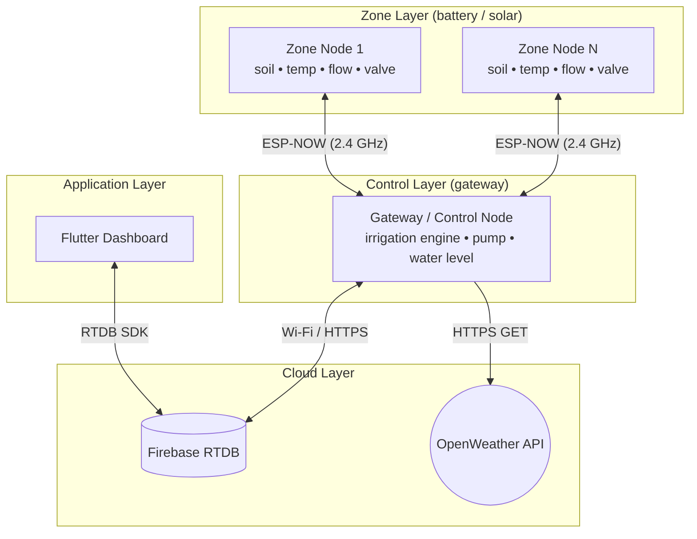

| Direction | Path | Protocol |
|-----------|------|----------|
| Zone → Gateway | soil moisture, temperature, flow, needs-water | ESP-NOW |
| Gateway → Zone | valve open/close commands | ESP-NOW (reliable, ACK'd) |
| Gateway → Firebase | gateway state, zone telemetry, weather | HTTPS REST (PUT) |
| Firebase → Gateway | mode, per-zone config, manual commands | HTTPS REST (GET poll, 2 s) |
| Firebase ↔ App | all reads + command writes | Firebase SDK (real-time streams) |

**The Flutter app never communicates with the ESP32 boards directly** — all interaction is
mediated through Firebase Realtime Database.

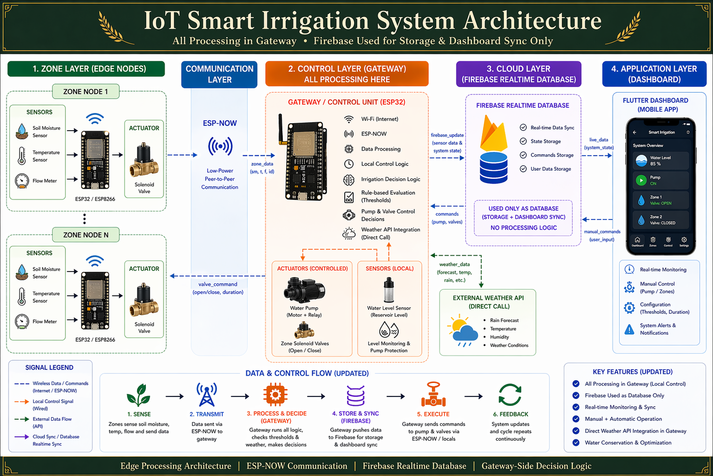

### Design objectives

| Objective | How it is met |
|-----------|---------------|
| Reliable irrigation | Closed-loop moisture control + duration limits + weather awareness |
| Safety | Pump active-LOW safe-OFF, valve 10-min auto-close, dry-run protection, uncalibrated-reading rejection, ACK'd valve commands |
| Maintainability | Pure-C component-based HAL/Services separation; layered Flutter app; documented APIs |
| Scalability | Up to 8 zones per gateway (NVS registry); extensible, versioned ESP-NOW protocol |
| Low power | Soil-sensor power-gating, event-driven tasks, no busy-wait polling |
| Observability | Per-board status LEDs + buzzer driven by an explicit lifecycle state machine |

---

## 2. Repository Layout

```
.
├── README.md                      # ← this document (the single project reference)
├── docs/
│   └── architecture.png           # system architecture diagram
│
├── PCBs/                          # KiCad hardware design (gateway + zone boards)
│   ├── Control Schematic.png      # rendered gateway schematic
│   ├── control 3D.png             # gateway board 3D render
│   ├── Zone Schematic.png         # rendered zone schematic
│   ├── Zone 3D.png                # zone board 3D render
│   ├── control/                   # GATEWAY KiCad project (.kicad_sch/_pcb/_pro) + BoM csv
│   ├── Zone/                      # ZONE KiCad project + gerbers/ + final_gerber/ + lib/
│   ├── light/                     # SMART LIGHTING relay board KiCad project + BoM csv
│   ├── gerbers/                   # fabrication outputs (control, zones, light)
│   ├── fritzing/                  # early breadboard prototypes (.fzz) + wiring images
│   └── BOM/                       # proof-of-concept bill of materials (.xlsx)
│
├── firebase/                      # Firebase RTDB data model (db.md), seed data, sample export
│
├── firmware/                      # ESP-IDF firmware (two apps + shared components)
│   ├── db.json                    # authoritative Firebase RTDB schema export
│   ├── common/                    # shared components (EXTRA_COMPONENT_DIRS)
│   │   ├── esp_now/               # protocol + reliable send
│   │   ├── led_driver/            # non-blocking LED (blink/pulse) via esp_timer
│   │   ├── buzzer_driver/         # active/passive buzzer pattern player
│   │   └── state_machine/         # tiny reusable FSM engine
│   ├── control/                   # GATEWAY app
│   │   └── main/
│   │       ├── HAL/{Pump,WaterLevel,WiFi,DcMotor,FlowMeter}/
│   │       ├── Services/{FirebaseAuth,FirebaseDB,FirebaseSync,Weather,IrrigationEngine}/
│   │       └── include/{app_config.h, firebase_config.h}
│   └── zone/                      # ZONE app
│       └── main/
│           ├── HAL/{soil_moisture,ds18b20,valve,FlowMeter}/
│           └── include/app_config.h
│
└── app/                           # Flutter mobile dashboard
    ├── lib/
    │   ├── core/                  # constants, theme, utils
    │   ├── data/                  # repositories + Firebase services
    │   ├── models/                # data models (gateway, zone, command, weather)
    │   ├── providers/             # Riverpod providers (streams + commands)
    │   ├── presentation/          # screens + widgets
    │   └── routes/                # GoRouter configuration
    ├── android/ ios/ web/ windows/ macos/ linux/
    └── pubspec.yaml
```

Design rules (firmware): hardware access lives in `HAL/`; business logic in `Services/`;
cross-cutting board-agnostic drivers live in `common/`. The irrigation engine never touches
GPIO directly — it calls the pump driver and sends ESP-NOW commands.

---

## 3. Hardware Reference

### 3.1 Boards & Power

Two ESP32-WROOM-32 board types share a solar power architecture
(solar → MPPT → battery → buck/LDO rails).

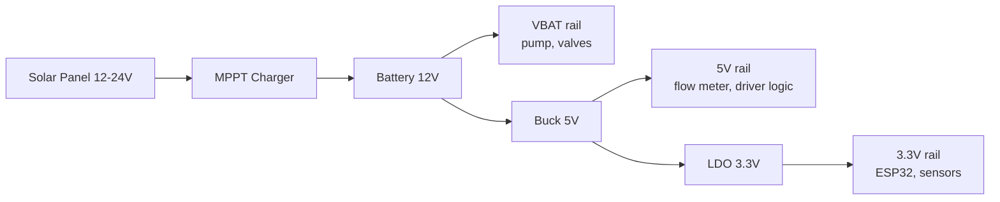

| Board | Qty | Actuators | Sensors | Indicators |
|-------|-----|-----------|---------|------------|
| **Gateway / Control** | 1 | Pump (MOSFET, active-LOW) | Water level (ADC) | Green/Yellow/Red LED + buzzer |
| **Zone** | N (≤8) | Solenoid valve (MOSFET) | Soil moisture (ADC, power-gated), DS18B20 temp, YFS-401 flow | Green/Yellow/Red LED + buzzer |

| Rail | Voltage | Consumers |
|------|---------|-----------|
| VBAT | 12–24 V | Water pump motor, solenoid valves |
| 5 V | 5 V | Flow meter, motor-driver logic |
| 3.3 V | 3.3 V | ESP32, DS18B20, soil moisture sensor, all GPIO logic |

**Power budget (typical):** ESP32 Wi-Fi 80–160 mA · ESP32 ESP-NOW 50–100 mA · soil sensor
10–20 mA (power-gated) · DS18B20 <1.5 mA · YFS-401 5–10 mA · solenoid coil 200–400 mA ·
pump 1–5 A (load dependent).

**Key PCB notes:** keep a 10 mm clear zone under the ESP32 PCB antenna; place a 4.7 kΩ
DS18B20 pull-up near its connector; route ADC traces away from switching/motor lines; add a
flyback diode across the solenoid coil and freewheeling diodes on the motor driver outputs;
100 nF close to each VCC pin + 10 µF bulk per rail.

### 3.2 Complete GPIO Mapping

**Gateway / Control Board**

| Function | GPIO | Notes |
|----------|------|-------|
| Pump switch | **GPIO25** | MOSFET, **active-LOW**: LOW = ON, HIGH = OFF (safe). Pull-up holds OFF at boot |
| Water level sensor | GPIO34 | ADC1_CH6, input-only |
| Buzzer | GPIO32 | LEDC tone (passive) |
| Green LED | GPIO26 | Healthy / idle |
| Yellow LED | GPIO27 | Busy / pump running |
| Red LED | GPIO14 | Fault / dry tank |

**Zone Board**

| Function | GPIO | Notes |
|----------|------|-------|
| Soil moisture ADC | GPIO35 | ADC1_CH7, input-only, power-gated |
| Soil sensor VCC control | GPIO25 | HIGH = sensor powered |
| Calibration button | GPIO0 | Boot button, active-LOW, ISR |
| DS18B20 data | GPIO18 | 1-Wire, 4.7 kΩ pull-up |
| Flow sensor (YFS-401) | GPIO19 | Rising-edge ISR |
| Valve | GPIO23 | MOSFET, HIGH = open |
| Red LED | GPIO32 | Fault / not paired |
| Yellow LED | GPIO26 | Valve open / calibrating |
| Green LED | GPIO27 | Paired / idle |
| Buzzer | GPIO33 | LEDC tone (passive) |

All pin assignments are centralised in each app's `main/include/app_config.h`.

### 3.3 Bill of Materials (minimum)

**Zone node:** ESP32-WROOM-32 · AMS1117-3.3 LDO · MP1584/LM2596 buck · IRLZ44N N-MOSFET
(valve) · 1N4007 flyback · 4.7 kΩ (DS18B20 pull-up) · 330 Ω (MOSFET gate) · 10 kΩ (flow
pull-up) · capacitive soil sensor · DS18B20 · YFS-401 flow meter · 12 V solenoid valve ·
tactile switches (calibration + reset) · screw terminals.

**Gateway node:** ESP32-WROOM-32 · motor driver (MOSFET/H-bridge) · AMS1117-3.3 LDO ·
Schottky freewheeling diodes · bypass/bulk caps · reset switch · screw terminals (pump,
water-level sensor, power).

### 3.4 PCB Design (KiCad)

The gateway and zone boards are custom two-layer PCBs designed in **KiCad 8**; a third board
drives the campus **smart-lighting** relays. The full design sources live in
[`PCBs/`](PCBs/) — schematics, layouts, fabrication gerbers and the bill-of-materials CSVs are
all version-controlled, so each board can be reviewed, edited and re-fabricated from this repo.

| Board | KiCad project | Fabrication outputs | BoM |
|-------|---------------|---------------------|-----|
| **Gateway / Control** | [`PCBs/control/control.kicad_pro`](PCBs/control/control.kicad_pro) | — | [`control.csv`](PCBs/control/control.csv) |
| **Zone** | [`PCBs/Zone/Zone.kicad_pro`](PCBs/Zone/Zone.kicad_pro) | [`gerber/`](PCBs/Zone/gerber/), [`final_gerber/`](PCBs/Zone/final_gerber/) | [`Zone.csv`](PCBs/Zone/Zone.csv) |
| **Smart Lighting** | [`PCBs/light/light.kicad_pro`](PCBs/light/light.kicad_pro) | [`gerbers/light/`](PCBs/gerbers/light/) | [`light.csv`](PCBs/light/light.csv) |

Fabrication-ready gerber + drill sets for every board are also collected in
[`PCBs/gerbers/`](PCBs/gerbers/) (`control/`, `zones/`, `Zones Single/`, `light/`). Early
breadboard prototypes made in **Fritzing** (`.fzz` + wiring images) are in
[`PCBs/fritzing/`](PCBs/fritzing/), and the proof-of-concept bill of materials is in
[`PCBs/BOM/`](PCBs/BOM/).

#### Smart Lighting board

A 12 V relay controller for campus lighting, built around a **NodeMCU (ESP-12E)**:

| Block | Parts |
|-------|-------|
| MCU | NodeMCU 1.0 (ESP-12E) on two 15-pin headers |
| Power | 12 V input → **LM2596** buck module → 5 V / 3.3 V rails, bulk + decoupling capacitors |
| Load switching | 4 × **SRD-12VDC-SL-C** relays, each isolated by a **PC817** optocoupler and driven by a **2N2222** transistor with a **1N4007** flyback diode (hierarchical sheet [`realy_module.kicad_sch`](PCBs/light/realy_module.kicad_sch)) |
| Indicators | 2 × **74HC595** shift registers driving 16 status LEDs |
| I/O | 5 × 2-pin screw terminals for supply and lamp outputs, TL2285EE push-button |

The zone project bundles its custom symbol/footprint library and the third-party YAAJ **LM2596**
buck-converter footprint under [`PCBs/Zone/lib/`](PCBs/Zone/lib/). Open a board with
`File → Open Project` in KiCad and use the 3D viewer to inspect placement and clearances.

| Gateway schematic | Gateway 3D | Zone schematic | Zone 3D |
|:-----------------:|:----------:|:--------------:|:-------:|
|  |  |  |  |

> **Repo hygiene:** KiCad auto-backups (`*-backups/`), autosaves, the `fp-info-cache`, per-user
> `*.kicad_prl` state and the heavy vendor 3D models (`*.step`/`*.wrl`) are git-ignored. The
> LM2596 STEP/WRL previews are downloadable from the vendor if you want the full 3D render.

---

## 4. ESP-NOW Network

A star topology: one gateway, up to 8 zones. No router is required for the local link; the
gateway additionally joins the home Wi-Fi AP for cloud access.

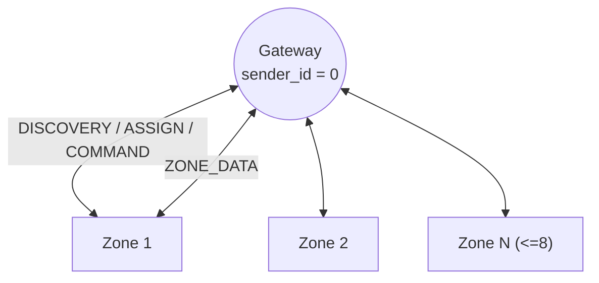

- **Protocol version 4** (`ESP_NOW_PROTOCOL_VERSION`). Every packet starts with a 3-byte
  header `{version, msg_type, sender_id}`; mismatched versions are dropped.
- **Channel:** the gateway tracks its Wi-Fi AP channel and pins ESP-NOW to it. Zones scan
  channels 1–13 during discovery, then persist the pairing.
- **MAC obfuscation:** zone MACs are XOR-obfuscated (key `0xA5`) inside discovery payloads — a
  lightweight anti-sniffing deterrent, not encryption.
- **Reliable delivery:** safety-critical valve commands use `EspNow_SendReliable()`, which
  waits for the link-layer ACK and retransmits (up to 4 attempts). Telemetry is best-effort.
- **Recovery:** a zone that sees 5 consecutive send failures wipes its pairing and re-discovers.

---

## 5. Firmware Design

ESP-IDF **v5.x**, component-based, **two apps + shared components**, pure C throughout.
Shared components are discovered through `EXTRA_COMPONENT_DIRS=../common` in each project's
top-level `CMakeLists.txt`.

### 5.1 Software Architecture

```
firmware/
├── common/        esp_now · led_driver · buzzer_driver · state_machine   (shared)
├── control/       GATEWAY  →  HAL/ + Services/ + include/
└── zone/          ZONE     →  HAL/ + include/
```

### 5.2 Gateway (Control) Node

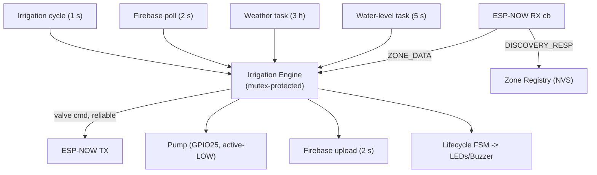

Responsibilities: zone discovery/registration (NVS), telemetry ingestion, the irrigation
decision engine, pump control with dry-run protection, weather fetch, and Firebase sync.

### 5.3 Zone Node

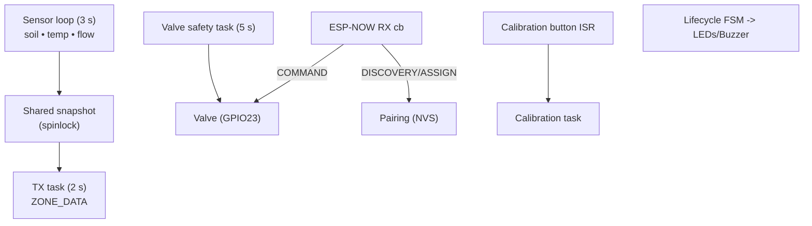

Responsibilities: sensor acquisition, pairing/discovery, valve actuation on gateway command,
interrupt-driven calibration, and the valve safety timeout (10-min auto-close).

### 5.4 Communication Flow

**Discovery & assignment**

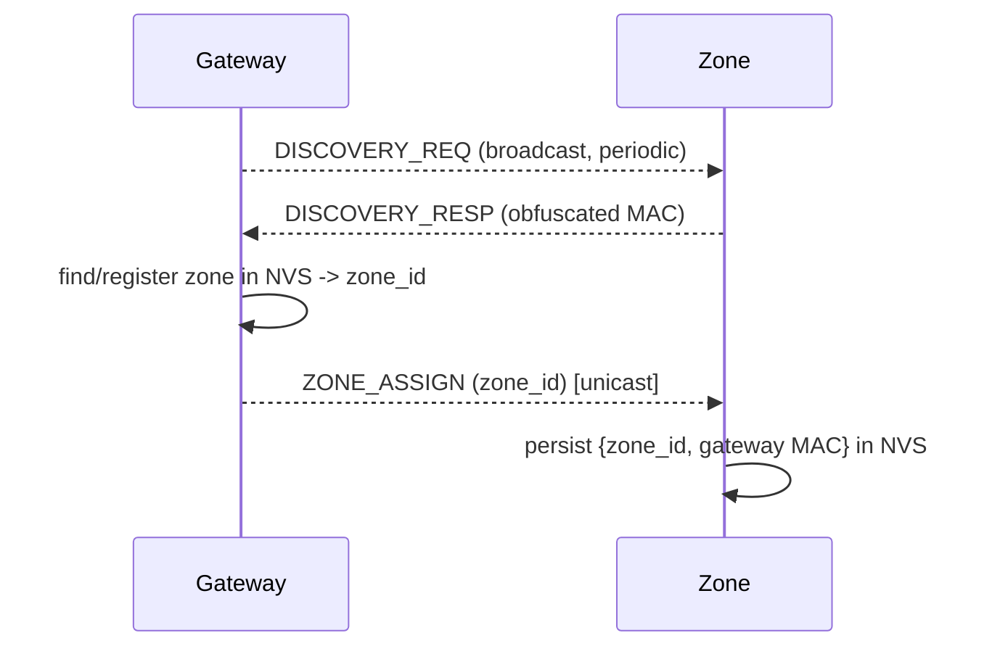

**Steady-state telemetry & control**

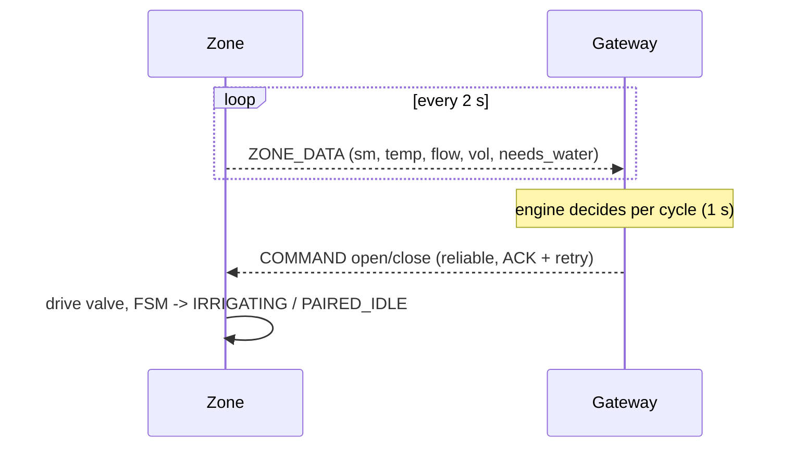

### 5.5 Packet Structures

All structs are `__attribute__((packed))` and prefixed with the common header.

```c
typedef struct __attribute__((packed)) {
    uint8_t version;     // = ESP_NOW_PROTOCOL_VERSION (4)
    uint8_t msg_type;    // EspNow_MsgType_t
    uint8_t sender_id;   // zone id, or 0 for the gateway
} EspNow_MessageHeader_t;
```

| Type | ID | Direction | Payload (beyond header) |
|------|----|-----------|-------------------------|
| `ZONE_DATA` | 1 | Zone → GW | `moisture%` (0xFF = invalid), `temp_x10` (-999 = invalid), `needs_water`, `total_volume_ml`, `flow_rate_x100` |
| `COMMAND` | 2 | GW → Zone | `target_zone_id`, `open_valve` |
| `DISCOVERY_REQ` | 3 | GW → bcast | — |
| `DISCOVERY_RESP` | 4 | Zone → GW | `obfuscated_mac[6]` |
| `ZONE_ASSIGN` | 5 | GW → Zone | `assigned_zone_id` |

Sentinels: `ESP_NOW_MOISTURE_INVALID = 0xFF`, `ESP_NOW_TEMP_INVALID = -999`. The gateway treats
an invalid moisture as out-of-range and will never irrigate on it.

### 5.6 State Machines

Both apps drive an explicit lifecycle FSM (`common/state_machine`) whose transitions are logged
and mapped to the status indicators.

**Gateway**

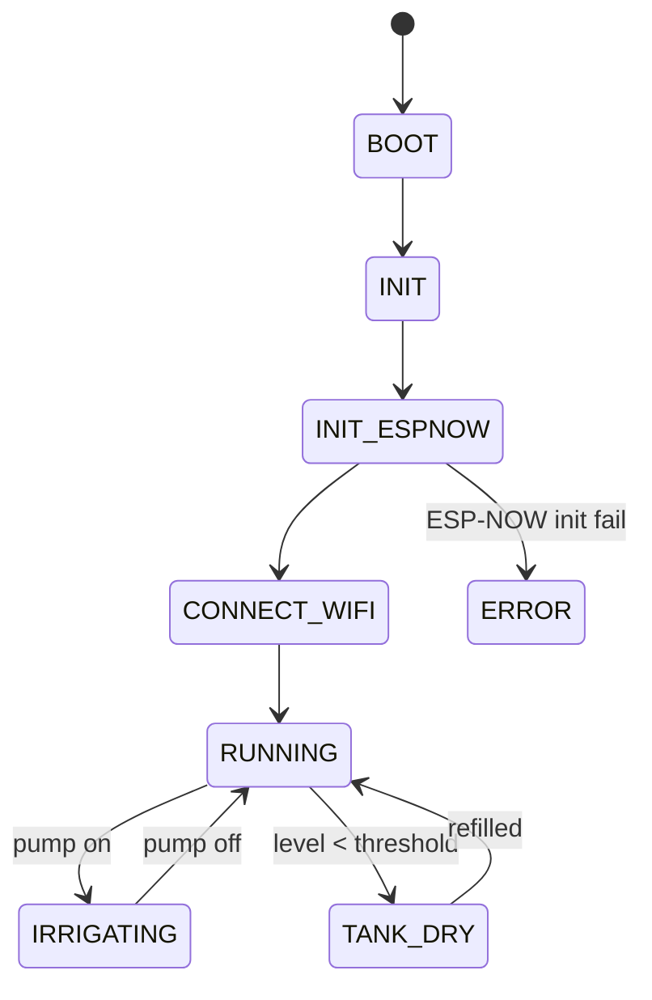

**Zone**

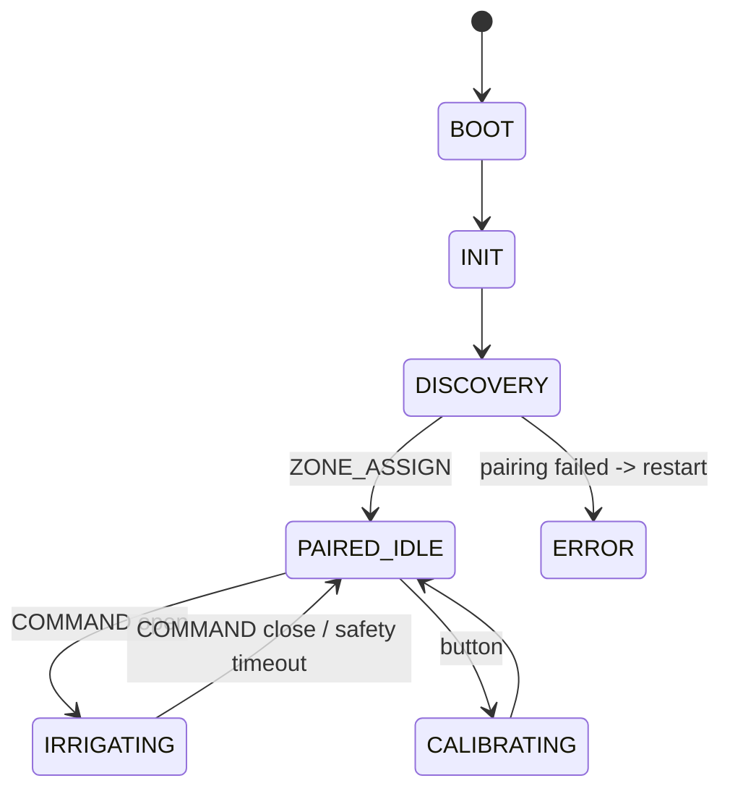

### 5.7 Sensor Processing

| Sensor | Processing | Failure handling |
|--------|-----------|------------------|
| **Soil moisture** | Power-gate ON → 100 ms settle → 64-sample average → map with NVS dry/wet calibration → 0–100 % → power OFF | **Uncalibrated/invalid ⇒ `valid=false`**; the zone transmits `0xFF` so the gateway never irrigates on it |
| **DS18B20** | 12-bit conversion, up to 3 retries; ~750 ms conv time | Invalid ⇒ `temp_x10 = -999`; does not block irrigation |
| **YFS-401 flow** | Rising-edge ISR increments a cumulative counter; rate from Δpulses/Δt; volume recomputed from the cumulative count in 64-bit (no truncation loss); spinlock guards counters across cores | Zero on first call; safe against div-by-zero |
| **Water level** | 16–32 sample average mapped between calibrated empty/full raw values; either polarity | Read failure ⇒ keep last value; `valid=false` disables dry-run gating (fails open) |

### 5.8 Irrigation Decision Logic

The engine runs every second under a mutex. Order of operations each cycle:

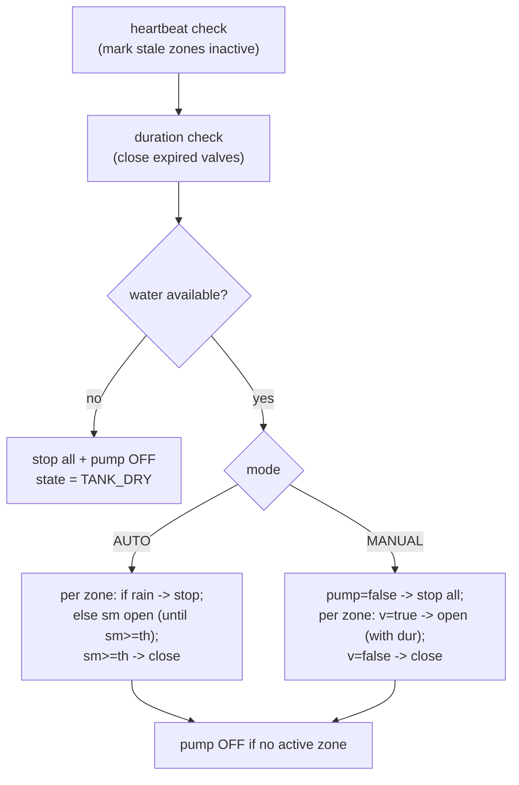

**Safety invariants**
- Pump ON requires water available **and** at least one eligible zone below threshold.
- A zone is *eligible* only if its data is valid, fresh (< 10 s) and in range — an invalid
  (`0xFF`) moisture is rejected at ingestion and can never start irrigation.
- The pump turns ON before any valve opens (`PUMP_SETTLE_DELAY_MS`), and OFF once no valve is open.
- Manual mode still enforces the threshold and dry-run safety.

### 5.9 Power Management

This deployment uses an **always-on** model because the gateway commands zone valves in real
time and auto mode is closed-loop on the live moisture stream. Within that model:

- **Soil sensor is power-gated** — energised only for the ~100 ms measurement window.
- **No busy-wait polling.** Calibration is interrupt-driven (button ISR); flow counting is
  ISR-driven; tasks block on timers/notifications/event-groups rather than spinning.
- **Water level** is sampled at a slow cadence (5 s).
- **Outputs default to safe/off** at boot and are disabled before the system goes idle.

> **Deep sleep was deliberately not enabled.** A sleeping zone cannot receive live valve
> `COMMAND` packets, and auto mode holds a valve open until the *streamed* moisture crosses the
> threshold. Adopting deep sleep requires a **zone-autonomous duty-cycle** protocol redesign
> (wake → measure → report → receive a fixed duration → run the valve locally → sleep), listed
> under [Future Improvements](#13-future-improvements).

### 5.10 Status LEDs & Buzzer

**Gateway**

| State | Green | Yellow | Red | Buzzer |
|-------|:-----:|:------:|:---:|--------|
| BOOT / INIT | off | fast blink | off | — |
| CONNECT_WIFI | off | slow blink | off | — |
| RUNNING (idle) | **on** | off | off | success chirp on entry |
| IRRIGATING | off | **on** | off | — |
| TANK_DRY | off | off | blink | warning |
| ERROR | off | off | **on** | error pattern |

**Zone**

| State | Green | Yellow | Red | Buzzer |
|-------|:-----:|:------:|:---:|--------|
| BOOT / INIT | off | fast blink | off | — |
| DISCOVERY (unpaired) | off | off | slow blink | — |
| PAIRED_IDLE | **on** | off | off | success on pairing |
| IRRIGATING (valve open) | off | **on** | off | — |
| CALIBRATING | off | fast blink | off | success/error on finish |
| ERROR | off | off | **on** | error pattern |

Buzzer patterns: `success` (rising two-tone), `warning` (two beeps), `error` (three low beeps),
`alarm` (continuous until stopped).

---

## 6. Cloud — Firebase

### 6.1 Architecture

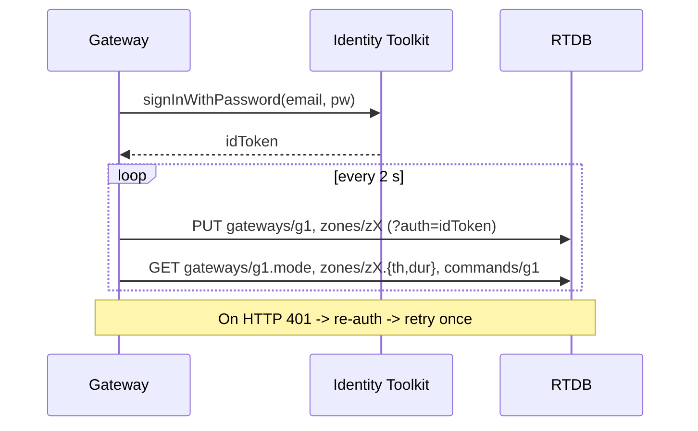

- **Auth:** email/password → `idToken`, attached as `?auth=` to every REST call. A `401`
  triggers a transparent re-login and one retry.
- **Upload (2 s, or immediate on critical change):** `gateways/g1` and `zones/z1..z2`.
- **Poll (2 s):** gateway `mode`, per-zone `th`/`dur`, and `commands/g1`.
- **Resilience:** read failures preserve the last known config; uploads never block the engine.
  Timestamps are only published once SNTP has synced (no bogus `-1`).

### 6.2 Database Schema

Authoritative export: [`firmware/db.json`](firmware/db.json). Firmware field names match exactly.

```
gateways/g1/
  ├─ mode        (string)  "auto" | "manual"        [cloud -> device]
  ├─ pump        (bool)    pump running              [device -> cloud]
  ├─ waterLevel  (number)  reservoir 0-100 %         [device -> cloud]
  └─ lastSeen    (number)  epoch ms                  [device -> cloud]

zones/z{1,2}/
  ├─ g    (string)  parent gateway id "g1"
  ├─ sm   (number)  soil moisture 0-100 %
  ├─ t    (number)  temperature C
  ├─ f    (number)  flow rate L/min
  ├─ v    (bool)    valve open
  ├─ lu   (number)  last update epoch ms
  ├─ th   (number)  moisture threshold %  [cloud -> device]
  ├─ dur  (number)  irrigation duration s [cloud -> device]
  └─ history/{id}   time-series readings (temp, moisture, flow, water used, valve, ts)

commands/g1/
  ├─ pump (bool)            master pump enable (false = stop all)  [cloud -> device]
  ├─ ts   (number)          command timestamp
  └─ z/z{1,2}/{ v(bool), d(number seconds), commandId, status }    [cloud -> device]

commandAcks/g1/z{1,2}/  { commandId, status, executedAt, message } [device -> cloud]

weather/  { temperature, humidity, condition, timestamp }          [device -> cloud]
```

**Schema notes**
- `f` carries the instantaneous flow rate in L/min (consistent with its name).
- `commands/g1/pump` is honoured as a master kill in manual mode.
- `waterLevel` is a real reading from the gateway's ADC.
- `history/` and `commandAcks/` support the app's charts and command-acknowledgement UX.

---

## 7. Mobile App (Flutter)

A cross-platform Flutter dashboard for real-time monitoring and manual control. It reads and
writes Firebase Realtime Database only — the same project the gateway authenticates against.

### 7.1 Architecture

Layered architecture with **Riverpod** for state and **GoRouter** for navigation. Firebase
listeners produce streams that Riverpod `StreamProvider`s expose to the UI; user actions go
through repositories that write command paths.

```
Firebase RTDB
   │  onValue streams
   ▼
Repositories (gateway / zone / command / weather / history)
   │
   ▼
Riverpod providers  →  Screens & widgets  →  user action  →  Repository.write(...)  →  RTDB
```

| Concern | Choice |
|---------|--------|
| Framework / language | Flutter 3.x · Dart 3.x |
| State management | `flutter_riverpod` (stream-native, compile-safe) |
| Routing | `go_router` |
| Backend | `firebase_core`, `firebase_database`, `firebase_auth` |
| UI | `google_fonts`, `percent_indicator`, `shimmer`, `connectivity_plus`, `intl` |

The app is **dark-themed, portrait-locked**, and enables Firebase offline persistence (10 MB
cache) so the last-known state is shown without connectivity.

### 7.2 Project Structure

```
app/lib/
├── main.dart                       # entry: Firebase init, persistence, ProviderScope
├── firebase_options.dart           # generated by FlutterFire CLI
├── core/
│   ├── constants/                  # firebase_paths.dart, app_constants.dart
│   ├── theme/                      # app_theme.dart, app_colors.dart
│   └── utils/                      # timestamp_utils.dart
├── data/
│   └── repositories/               # gateway, zone, command, weather, history
├── models/                         # gateway, zone_data, zone_reading, zone_command, weather, app_enums
├── providers/                      # gateway, zone, weather, command, history, alerts, connectivity
├── presentation/
│   ├── screens/                    # main, dashboard, config, alerts, zone_detail
│   └── widgets/                    # zone_card, moisture_gauge, weather_widget, mode_toggle,
│                                   #   valve_control_button, pump_status_badge, glass_card, …
└── routes/
    └── app_router.dart             # GoRouter: '/' (MainScreen) + '/zone/:zoneId'
```

**Navigation:** a single `MainScreen` hosts a bottom navigation bar — **Dashboard**, **Config**
and **Alerts** — plus a `/zone/:zoneId` detail route. Screens:

| Screen | Purpose |
|--------|---------|
| **Dashboard** | Gateway online/mode/pump status, weather widget, per-zone summary cards |
| **Zone Detail** | Moisture gauge, temperature, flow, valve state, threshold/duration editors, history chart |
| **Config** | System mode toggle (auto/manual) and per-zone thresholds & durations |
| **Alerts** | Gateway-offline, stale-zone and connectivity warnings |

**Staleness rules:** zone stale > 15 s (amber badge), zone offline > 60 s (red, controls
disabled), gateway offline > 30 s (banner). Manual valve/pump controls are enabled only in
manual mode and require a confirmation dialog.

### 7.3 Command & Control Mapping

The gateway polls `commands/g1` every 2 s; the app writes these paths and the firmware acts on
the next poll (≈0–2 s latency). Path constants live in `lib/core/constants/firebase_paths.dart`.

| User action | Write | Path | Value |
|-------------|-------|------|-------|
| Switch mode | `set` | `gateways/g1/mode` | `"auto"` / `"manual"` |
| Open zone valve | `update` | `commands/g1/z/<id>` | `{ v: true, d: <seconds> }` |
| Close zone valve | `update` | `commands/g1/z/<id>` | `{ v: false, d: 0 }` |
| Pump on/off | `set` | `commands/g1/pump` | `true` / `false` |
| Set threshold | `set` | `zones/<id>/th` | `0–100` |
| Set duration | `set` | `zones/<id>/dur` | seconds |
| (every command) | `set` | `commands/g1/ts` | epoch |

---

## 8. Build, Flash & Run

### Firmware (ESP-IDF v5.x)

Prerequisites: ESP-IDF v5.x installed and exported (`. $IDF_PATH/export.sh`), target `esp32`.

```bash
# Gateway / control board
cd firmware/control
cp main/include/secrets.example.h main/include/secrets.h   # first time only: add your credentials
idf.py set-target esp32
idf.py build
idf.py -p <PORT> flash monitor       # PORT e.g. COM5 (Windows) or /dev/ttyUSB0 (Linux)

# Zone board (separate terminal / build dir)
cd firmware/zone
idf.py set-target esp32
idf.py build
idf.py -p <PORT> flash monitor
```

The zone app pulls `espressif/ds18b20` and `espressif/onewire_bus` via the component manager
(`zone/main/idf_component.yml`).

**First-boot sequence**
1. Flash the **gateway** first; confirm it connects to Wi-Fi and logs its channel.
2. Flash a **zone**; it scans channels, pairs, and persists its `zone_id`.
3. To re-pair a zone, erase its NVS: `idf.py -p <PORT> erase-flash`, then re-flash.

### Mobile app (Flutter)

Prerequisites: Flutter SDK 3.x (stable), an Android/iOS toolchain, and access to the Firebase
project.

```bash
cd app
flutter pub get

# (first time) regenerate Firebase config for your project:
#   dart pub global activate flutterfire_cli
#   flutterfire configure
flutter run
```

`google-services.json` / `GoogleService-Info.plist` are placed by the FlutterFire CLI and are
**git-ignored** — each developer configures their own.

---

## 9. Configuration Guide

| What | Where |
|------|-------|
| Wi-Fi SSID / password | `firmware/control/main/include/secrets.h` → `WIFI_SSID`, `WIFI_PASS` |
| OpenWeather API key | `secrets.h` → `WEATHER_API_KEY` |
| Pump pin / polarity | `control/.../app_config.h` → `PUMP_RELAY_GPIO`, `PUMP_ACTIVE_HIGH` |
| Water-level calibration | `WATER_LEVEL_RAW_EMPTY/FULL`, `WATER_LEVEL_DRY_THRESHOLD` |
| Status LED / buzzer pins | both `app_config.h` files |
| Default thresholds & durations | `DEFAULT_Z*_THRESHOLD`, `DEFAULT_Z*_DURATION` (overridable from Firebase) |
| Firebase API key / login / DB URL | `secrets.h` → `FIREBASE_API_KEY`, `FIREBASE_AUTH_EMAIL`, `FIREBASE_AUTH_PASSWORD`, `FIREBASE_DB_URL` |
| Firebase IDs & timing | `firmware/control/main/include/firebase_config.h` |
| ESP-NOW channel (zone hint) | `firmware/zone/main/include/app_config.h` → `ESP_NOW_CHANNEL` |
| App Firebase config | `app/lib/firebase_options.dart` (generated) |
| App RTDB paths & zone IDs | `app/lib/core/constants/firebase_paths.dart` |

> **Secrets:** all credentials live in `firmware/control/main/include/secrets.h`, which is
> git-ignored. Before building the gateway, copy the template and fill in your own values:
>
> ```bash
> cp firmware/control/main/include/secrets.example.h firmware/control/main/include/secrets.h
> ```
>
> The build stops with a clear `#error` if `secrets.h` is missing. The `.gitignore` also excludes
> `*.env`, `google-services.json` and `GoogleService-Info.plist`.

---

## 10. Testing Procedures

| Test | Procedure | Expected |
|------|-----------|----------|
| Pairing | Power gateway, then zone | Zone LED: red-blink → green; gateway logs `ZONE_ASSIGN` |
| Calibration | Press zone button; follow wet/dry prompts | Yellow fast-blink during; success chirp; subsequent `sm` valid |
| Uncalibrated safety | Erase zone NVS, run without calibrating | Gateway logs moisture INVALID; **no irrigation** |
| Auto irrigation | Set `mode=auto`, dry the sensor below `th` | Pump ON, valve opens, stops when `sm ≥ th` |
| Manual control | `mode=manual`, set `commands/g1/z/z1/{v:true,d:30}` | Valve opens ~30 s; `v:false` closes immediately |
| Dry-run protection | Drop water level below threshold | `TANK_DRY`, pump inhibited, red blink + warning |
| Valve reliability | Power-cycle a zone mid-cycle | Gateway logs reliable-send retries; valve reaches commanded state |
| Comms loss | Power off gateway while a valve is open | Zone auto-closes valve at 10-min safety timeout |
| App round-trip | Toggle mode / open a valve in the app | Firebase path updates; gateway acts within ~2 s; UI reflects new state |

---

## 11. Troubleshooting

| Symptom | Likely cause | Fix |
|---------|--------------|-----|
| Zone never pairs | Channel mismatch / out of range | Confirm gateway Wi-Fi channel; bring nodes closer; check zone `DISCOVERY` logs |
| Moisture always INVALID | Sensor never calibrated | Run the calibration routine (button) |
| Pump never runs | Tank dry, or all zones above threshold | Check `waterLevel`, thresholds, sensor validity |
| Pump runs at boot | Wrong polarity wiring | Verify `PUMP_ACTIVE_HIGH=false` and MOSFET is low-side active-LOW |
| No cloud updates | Wi-Fi / auth failure | Check SSID/pass, Firebase key/URL, look for `401` → re-auth logs |
| Valve stuck open | Lost comms | Zone safety closes at 10 min; check ESP-NOW link |
| `waterLevel` looks wrong | Uncalibrated ADC references | Set `WATER_LEVEL_RAW_EMPTY/FULL` for your sensor |
| App shows stale data | Gateway offline or no internet | Check gateway power/Wi-Fi; the app banner indicates connectivity state |

---

## 12. Error Handling & Safety

- **Fail-safe defaults:** pump and valve initialise OFF/closed with pull resistors holding the
  safe level through reset; outputs are driven safe before idle.
- **Input validation:** every ESP-NOW packet is length- and version-checked; sensor ranges are
  validated; invalid moisture cannot trigger irrigation.
- **Acknowledged commands:** valve commands retransmit until ACK'd (bounded) so a dropped frame
  doesn't strand a valve until the safety timeout.
- **Graceful cloud degradation:** read failures keep the last known config; uploads retry next
  cycle; `401` re-authenticates and retries once.
- **Self-recovery:** zones wipe pairing and re-discover after repeated send failures; the
  gateway enters the ERROR state on ESP-NOW init failure.
- **Watchdog-friendly:** no unbounded busy loops; long operations yield via FreeRTOS delays.
- **Concurrency:** engine state is mutex-protected; zone sensor snapshots and the flow counter
  use spinlocks for consistent, cross-core-safe access.

---

## 13. Future Improvements

1. **Zone-autonomous deep sleep** protocol (§5.9) for multi-month battery life.
2. **Encrypted ESP-NOW** (LMK/PMK) replacing MAC obfuscation.
3. **Per-zone water budgeting** using the accurate flow totals (leak detection, litres/day).
4. **OTA updates** for both firmware apps (partition table already supports it).
5. **Firebase `PATCH`** instead of `PUT` to avoid clobbering concurrent edits; exponential backoff.
6. **Sequence numbers / dedup** in ESP-NOW for stricter idempotency.
7. **Scale beyond 2 cloud zones** — extend the gateway's Firebase mapping to the full 8-zone registry.
8. **Push notifications** (FCM) for alerts; **historical analytics** dashboard in the app.
9. **Move secrets to NVS / secure storage** out of source control.

---

## 14. License

Released under the **MIT License**. See [`LICENSE`](LICENSE).

---

*Graduation Project — Solar-Powered IoT Smart Irrigation System.*
*Firmware: `firmware/control` (gateway), `firmware/zone` (zone), `firmware/common` (shared).*
*Cloud schema: `firmware/db.json`. Mobile app: `app/`.*
